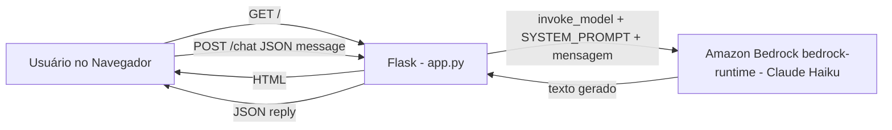
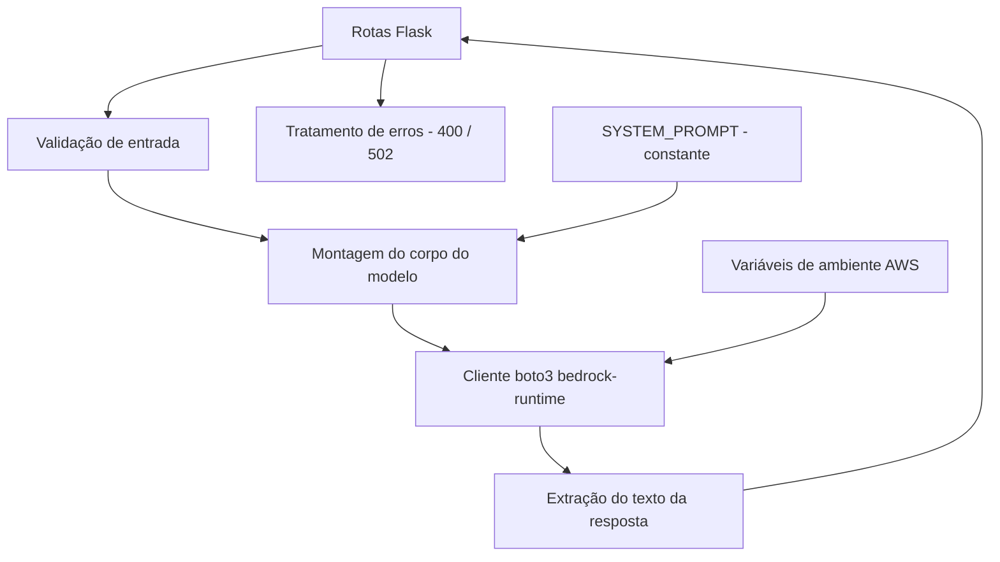
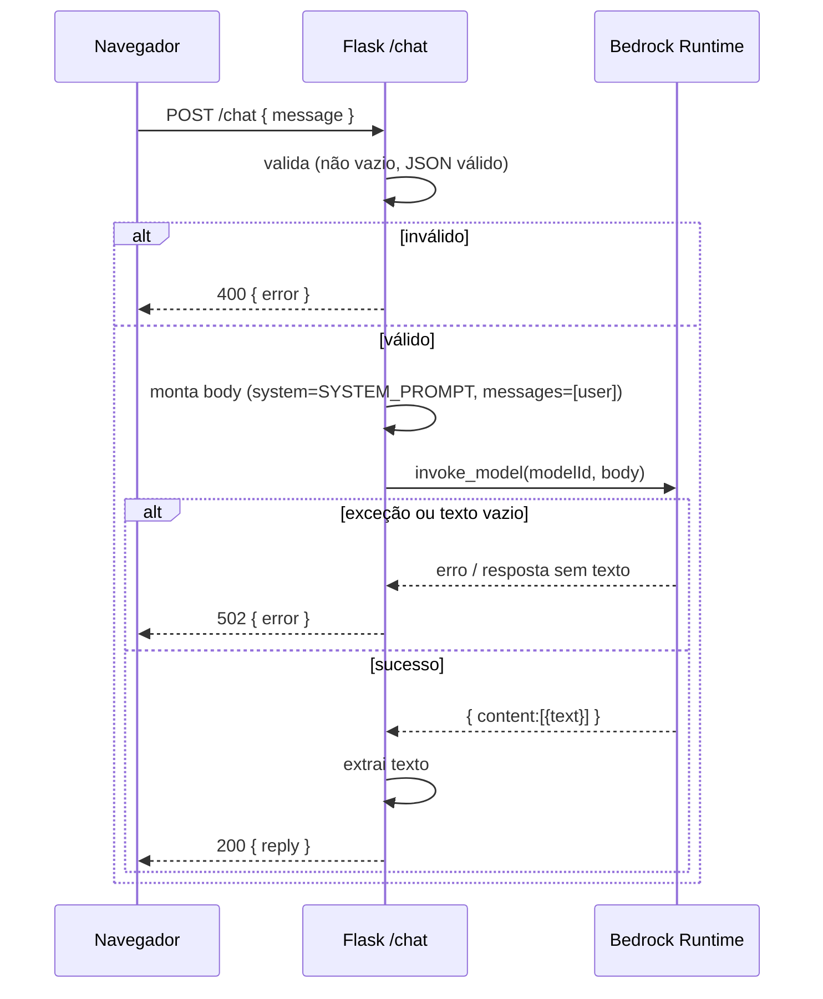

# Documento de Design

## Visão Geral

O Minguinho é uma aplicação web mínima e didática construída com **Python + Flask**. Ela expõe uma página de chat no navegador e um endpoint que recebe a mensagem do usuário, consulta o modelo **Claude Haiku** da **Amazon Bedrock** (via `boto3`) e devolve a resposta gerada. A personalidade, o tom e os limites de assunto do bot vivem em uma única constante `SYSTEM_PROMPT` dentro de `app.py`.

O projeto segue estritamente a stack obrigatória do steering e mantém-se enxuto: três arquivos (`app.py`, `templates/index.html`, `requirements.txt`), sem banco de dados, sem autenticação, sem testes automatizados, sem frameworks alternativos (FastAPI/Django) e sem outras APIs de IA além do Bedrock.

Objetivos de design:

- **Simplicidade**: código curto, legível e comentado em português.
- **Contrato HTTP claro**: `GET /` serve a página; `POST /chat` troca JSON `{message}` → `{reply}`.
- **Segurança básica**: credenciais AWS só via variáveis de ambiente; erros sem vazar detalhes internos.
- **Legibilidade pt-BR**: JSON com acentos preservados (UTF-8, sem escapes ASCII).

### Mapa de requisitos para seções deste design

| Requisito | Onde é tratado neste design |
|-----------|-----------------------------|
| 1 (página de chat) | Componentes → Rota Raiz; Interface do usuário (index.html) |
| 2 (processamento) | Componentes → Rota Chat; Fluxo de invocação do Bedrock |
| 3 (validação vazia) | Componentes → Rota Chat; Tratamento de erros |
| 4 (geração via Bedrock) | Fluxo de invocação do Bedrock; Modelos de dados |
| 5 (personalidade) | Estratégia do SYSTEM_PROMPT |
| 6 (credenciais AWS) | Arquitetura → segurança; Tratamento de erros (startup) |
| 7 (JSON com acentos) | Configuração JSON/UTF-8 |
| 8 (falhas do modelo) | Tratamento de erros |
| 9 (estrutura/execução) | Estrutura de arquivos; Inicialização |

## Arquitetura

O fluxo é linear e sem estado persistente no servidor: o navegador conversa com o Flask, que conversa com o Bedrock.



### Camadas lógicas (dentro de um único `app.py`)



Decisões de arquitetura e justificativas:

- **Servidor sem estado**: o histórico da conversa vive apenas no navegador (em memória da página). Isso elimina a necessidade de banco de dados e mantém o projeto mínimo (Requisitos 1.5, 9). Cada chamada ao `/chat` é independente.
- **Um único arquivo `app.py`**: concentra rotas, validação, `SYSTEM_PROMPT` e integração com o Bedrock, favorecendo o caráter didático exigido pelo steering.
- **Cliente Bedrock criado uma vez na inicialização**: o `boto3.client("bedrock-runtime", region_name="us-east-1")` é instanciado no startup, reaproveitando credenciais lidas do ambiente (Requisito 6).
- **Separação de responsabilidades por funções**: funções pequenas para validar entrada, montar o corpo do modelo, invocar o Bedrock e extrair o texto. Isso torna cada regra verificável manualmente.

### Segurança e credenciais

- As credenciais AWS (`AWS_ACCESS_KEY_ID`, `AWS_SECRET_ACCESS_KEY` e, se aplicável, `AWS_SESSION_TOKEN`) são resolvidas pelo próprio `boto3` a partir das **variáveis de ambiente** (Requisito 6.1). Nenhuma chave literal aparece no código (Requisito 6.2).
- Na inicialização, o app verifica a presença das variáveis essenciais e, se ausentes, registra mensagem e interrompe o startup (Requisito 6.3).
- Mensagens de erro nunca incluem valores de credenciais nem detalhes internos de exceções (Requisitos 6.4, 8.2).

## Componentes e Interfaces

### Componente 1: Rota Raiz — `GET /`

Responsabilidade: servir a página de chat.

- **Entrada**: requisição `GET /`.
- **Saída**: HTML renderizado de `templates/index.html` (via `render_template`).
- **Erro**: se o template não puder ser carregado/renderizado, responder com erro amigável (HTTP 500) sem derrubar o processo (Requisito 1.2).

```
GET /
200 OK  -> text/html (página de chat)
500     -> mensagem indicando que a página não pôde ser exibida
```

### Componente 2: Rota Chat — `POST /chat`

Responsabilidade: validar a mensagem, invocar o Bedrock e devolver a resposta.

Contrato de requisição:

```
POST /chat
Content-Type: application/json
{ "message": "texto do usuário" }
```

Contrato de resposta (sucesso):

```
200 OK
Content-Type: application/json; charset=utf-8
{ "reply": "resposta do Minguinho" }
```

Contratos de resposta (erro):

```
400 Bad Request   -> { "error": "mensagem em português" }   (mensagem ausente/vazia ou corpo inválido)
502 Bad Gateway   -> { "error": "mensagem em português" }   (falha na invocação do Bedrock ou resposta sem texto)
```

Pseudofluxo da rota:

```
1. Ler o corpo JSON. Se o corpo não for JSON válido -> 400 (erro pt).           (Req 3.4)
2. Se não existir o campo "message" -> 400 (erro pt).                           (Req 3.1, 3.3)
3. texto = message.strip(). Se len(texto) == 0 -> 400 (erro pt).                (Req 3.2, 3.3)
   -> Em qualquer caso de 400, NÃO chamar o Bedrock.                            (Req 3.5)
4. Invocar o Bedrock com SYSTEM_PROMPT + texto.                                 (Req 2.1, 4.x)
5. Extrair o texto gerado.
   -> Se vazio/ausente -> 502 (erro pt).                                        (Req 4.5)
   -> Se exceção na invocação -> 502 (erro pt), app continua vivo.              (Req 8.x)
6. Responder 200 com { "reply": texto_gerado }.                                 (Req 2.2)
```

### Componente 3: Integração com o Bedrock

Responsabilidade: encapsular a chamada ao modelo.

- Cliente: `boto3.client("bedrock-runtime", region_name="us-east-1")` (Requisito 4.1).
- Operação: `invoke_model` (Requisito 4.1).
- `modelId`: `us.anthropic.claude-haiku-4-5-20251001-v1:0` (perfil de inferência, exatamente este — Requisito 4.2).
- Corpo: formato de mensagens da API Anthropic no Bedrock, incluindo `SYSTEM_PROMPT` e a mensagem do usuário (Requisito 4.3).
- Extração: ler o texto do primeiro bloco de conteúdo de tipo texto da resposta (Requisito 4.4).

### Componente 4: `SYSTEM_PROMPT` (constante em `app.py`)

Responsabilidade: definir identidade, tom e limites do Minguinho (Requisitos 5.1–5.9). Detalhado em "Estratégia do SYSTEM_PROMPT".

### Componente 5: Interface do usuário — `templates/index.html`

Responsabilidade: apresentar o chat e manter o histórico em memória do navegador.

- Campo de texto aceitando de 1 a 2000 caracteres e um botão/controle de envio (Requisito 1.3).
- Área de histórico que anexa, em ordem cronológica, cada mensagem do usuário e cada resposta do bot (Requisito 1.4).
- JavaScript simples (fetch) que faz `POST /chat` e insere a resposta no histórico.
- Histórico mantido apenas em memória da página (array em JS); descartado ao recarregar/fechar (Requisito 1.5). Sem `localStorage`, sem cookies, sem persistência.

## Modelos de Dados

Não há persistência. Os "modelos" são apenas as formas dos corpos JSON trocados.

### Requisição para `/chat`

```json
{ "message": "Qual anime você recomenda?" }
```

- `message`: string. Após `strip()`, deve ter comprimento entre 1 e 2000 (limite de tamanho aplicado pela UI; o servidor valida apenas não-vazio).

### Resposta de sucesso de `/chat`

```json
{ "reply": "Que delícia de pergunta! 😊 ..." }
```

- `reply`: string com o texto gerado pelo modelo.

### Resposta de erro de `/chat`

```json
{ "error": "A mensagem é obrigatória e não pode estar vazia." }
```

- `error`: string em português, sem detalhes internos de exceção nem valores de credenciais.

### Corpo enviado ao modelo (Anthropic Messages API via `invoke_model`)

O corpo é um JSON serializado (campo `body` de `invoke_model`) com a forma:

```json
{
  "anthropic_version": "bedrock-2023-05-31",
  "max_tokens": 1024,
  "system": "<conteúdo do SYSTEM_PROMPT>",
  "messages": [
    { "role": "user", "content": [ { "type": "text", "text": "<Mensagem_Usuario>" } ] }
  ]
}
```

- `system`: recebe o `SYSTEM_PROMPT` (Requisito 4.3).
- `messages[0]`: a mensagem do usuário (Requisito 4.3).
- `anthropic_version` e `max_tokens` são parâmetros exigidos/esperados pela API de mensagens Anthropic no Bedrock.

### Forma da resposta do modelo (lida do `body`)

```json
{
  "content": [ { "type": "text", "text": "<texto gerado>" } ],
  "stop_reason": "end_turn"
}
```

- Extração do `reply`: concatenar/ler o `text` dos blocos de `content` cujo `type` é `text` (Requisito 4.4). Se não houver texto ou for vazio → tratar como falha (502, Requisito 4.5).

### Fluxo de invocação do Bedrock (detalhado)



## Estratégia do SYSTEM_PROMPT

A constante `SYSTEM_PROMPT` (em `app.py`, Requisito 5.4) é um texto em português que instrui o modelo. Ela deve conter, de forma explícita, as seguintes diretrizes (mapeadas aos critérios do Requisito 5):

- **Identidade e nome** (5.1, 5.6): o bot se chama "Minguinho"; é fofinho, bonitinho, caloroso e acolhedor, com tom doce que **não** é enjoativo nem exagerado; é curioso e amigável e faz perguntas de acompanhamento.
- **Escopo de temas** (5.2, 5.8): conversa exclusivamente sobre os cinco temas suportados — jogos, séries de TV, livros, animes e artistas — demonstrando conhecimento amplo e profundo de cultura pop nesses temas.
- **Idioma** (5.3): responde sempre em português.
- **Uso equilibrado de emojis e palavras confortantes** (5.7): usa emojis e expressões acolhedoras de forma moderada, limitando-se a **no máximo 3 emojis por resposta**.
- **Fora de escopo** (5.5): quando o usuário tratar de assunto fora dos cinco temas, o Minguinho indica gentilmente que está fora do seu escopo e propõe retomar a conversa em pelo menos um dos temas suportados.
- **Esportes** (5.9): quando o usuário tratar de esportes, o Minguinho reconhece de forma gentil e acolhedora que esportes não é um tema que domina bem e propõe retomar a conversa em pelo menos um dos cinco temas.

Estratégia de redação: o prompt é escrito em seções curtas e diretas (identidade, tom, temas, regras de emoji, redirecionamentos), para que o modelo siga as regras de forma consistente. O limite de emojis e o tom "não enjoativo" são declarados explicitamente para evitar excessos.

## Correctness Properties

*Uma propriedade é uma característica ou comportamento que deve ser verdadeiro em todas as execuções válidas do sistema — essencialmente, uma afirmação formal sobre o que o sistema deve fazer. Propriedades servem de ponte entre especificações legíveis por humanos e garantias de correção verificáveis por máquina.*

**Nota importante sobre verificação:** o steering do projeto **proíbe testes automatizados**. Portanto, as propriedades abaixo são **documentadas para raciocínio e verificação manual** (inspeção de código e testes exploratórios manuais), e **não** são implementadas como uma suíte de testes. Propriedades que dependem do comportamento não-determinístico do modelo de linguagem (ex.: tom, escolha de palavras) foram deliberadamente omitidas por não serem verificáveis de forma determinística.

Observação de reflexão (eliminação de redundância): os critérios 3.1, 3.2 e 3.4 foram consolidados em uma única propriedade de validação de entrada (Propriedade 1), já que todos descrevem "entrada inválida → 400 + erro pt + nenhuma chamada ao Bedrock". Os critérios 2.2/2.3/2.4 foram consolidados na Propriedade 3 (formato e código de sucesso). Os critérios 4.2/4.3 foram consolidados na Propriedade 4 (invariantes do corpo de invocação).

### Propriedade 1: Entrada inválida é sempre rejeitada com 400 e sem chamar o Bedrock

*Para qualquer* corpo de requisição ao `/chat` que seja (a) JSON inválido/ausente, (b) JSON sem o campo `message`, ou (c) JSON cujo `message` resulte em texto vazio após remoção de espaços, tabulações e quebras de linha — a resposta deve ter status HTTP 400, conter um campo `error` com texto em português identificando o problema, e **nenhuma** invocação ao Servico_Bedrock deve ocorrer.

**Validates: Requirements 3.1, 3.2, 3.3, 3.4, 3.5**

### Propriedade 2: Mensagem válida é encaminhada ao Bedrock

*Para qualquer* `message` cujo texto, após `strip()`, seja não-vazio, a Rota_Chat deve invocar o Servico_Bedrock exatamente uma vez com esse texto.

**Validates: Requirements 2.1**

### Propriedade 3: Resposta de sucesso tem formato e status corretos

*Para qualquer* texto gerado não-vazio retornado pelo modelo, a resposta HTTP deve ter status 200, corpo JSON contendo exatamente o campo `reply` (string) igual ao texto extraído do modelo.

**Validates: Requirements 2.2, 2.3, 2.4, 4.4**

### Propriedade 4: Invariantes do corpo de invocação do modelo

*Para qualquer* mensagem válida encaminhada ao Servico_Bedrock, o corpo enviado ao `invoke_model` deve usar exatamente o Model_ID `us.anthropic.claude-haiku-4-5-20251001-v1:0` e deve conter tanto o conteúdo do `SYSTEM_PROMPT` (campo `system`) quanto o texto da Mensagem_Usuario (em `messages`).

**Validates: Requirements 4.2, 4.3**

### Propriedade 5: Resposta do modelo sem texto vira 502

*Para qualquer* resposta do modelo que não contenha texto gerado ou cujo texto seja vazio, a Aplicacao_Flask deve responder com status 502 e corpo JSON com campo `error` em português.

**Validates: Requirements 4.5**

### Propriedade 6: Exceção na invocação vira 502 sem derrubar o servidor nem vazar detalhes

*Para qualquer* exceção levantada durante a invocação do Servico_Bedrock, a Aplicacao_Flask deve responder com status 502 e corpo JSON com campo `error` em português que não exponha detalhes internos da exceção, e o servidor deve permanecer em execução, atendendo requisições subsequentes na Rota_Chat.

**Validates: Requirements 8.1, 8.2, 8.3**

### Propriedade 7: Nenhuma resposta de erro vaza credenciais AWS

*Para qualquer* resposta de erro produzida pela Aplicacao_Flask (incluindo falhas de autenticação na AWS), o corpo da resposta não deve conter valores de credenciais AWS.

**Validates: Requirements 6.4**

### Propriedade 8: JSON preserva acentos em UTF-8 sem escapes ASCII

*Para qualquer* corpo JSON devolvido pela Aplicacao_Flask que contenha caracteres acentuados do português (á, â, ã, à, é, ê, í, ó, ô, õ, ú, ç e suas maiúsculas), esses caracteres devem aparecer literalmente codificados em UTF-8, sem serem convertidos em sequências de escape ASCII (`\uXXXX`), e o cabeçalho `Content-Type` deve indicar `charset=utf-8`.

**Validates: Requirements 7.1, 7.2, 7.3**

### Propriedade 9: Histórico do navegador preserva a ordem cronológica

*Para qualquer* sequência de mensagens enviadas e respostas recebidas em uma sessão, o histórico exibido na Pagina_Chat deve conter todas as mensagens na mesma ordem em que foram produzidas (ordem cronológica).

**Validates: Requirements 1.4**

## Tratamento de Erros

A aplicação distingue erros do cliente (400), falhas do serviço de IA (502) e erros de inicialização, sempre devolvendo JSON em português quando aplicável e mantendo o servidor vivo após falhas em requisições.

### Erros de requisição (`/chat`) — HTTP 400

| Situação | Ação |
|----------|------|
| Corpo ausente ou não é JSON válido (Req 3.4) | 400 + `{ "error": "O corpo da requisição é inválido. Envie um JSON com o campo \"message\"." }` |
| Campo `message` ausente (Req 3.1) | 400 + `{ "error": "A mensagem é obrigatória e não pode estar vazia." }` |
| `message` vazio após `strip()` (Req 3.2) | 400 + mesma mensagem acima |

- Em todos os casos de 400, **nenhuma** chamada ao Bedrock é feita (Req 3.5).
- A validação de JSON usa leitura tolerante (`silent`) para capturar corpo ausente/malformado e converter em 400, em vez de deixar o Flask lançar erro padrão.

### Falhas do serviço de IA (`/chat`) — HTTP 502

| Situação | Ação |
|----------|------|
| Exceção na invocação do Bedrock (Req 8.1) | capturar a exceção, responder 502 + `{ "error": "O serviço de IA falhou. Tente novamente em instantes." }` |
| Credenciais AWS inválidas (Req 6.4) | responder com mensagem de falha de autenticação com a AWS, sem expor valores das credenciais |
| Resposta do modelo sem texto/vazia (Req 4.5) | responder 502 + mensagem descritiva em português |

- As mensagens de erro **não** incluem a mensagem/stack da exceção nem valores de credenciais (Req 8.2, 6.4).
- A exceção é tratada com `try/except` dentro da rota, de modo que o servidor continua aceitando requisições (Req 8.3).

### Erros de página (`/`) — HTTP 500

- Se `render_template` falhar (ex.: template ausente), capturar e responder com mensagem indicando que a página não pôde ser exibida, sem encerrar a aplicação (Req 1.2).

### Erros de inicialização (startup)

| Situação | Ação |
|----------|------|
| Variáveis de ambiente de credenciais AWS ausentes (Req 6.3) | registrar mensagem clara e **interromper** a inicialização (encerrar com código de erro) antes de iniciar o servidor |
| Porta 5000 já em uso (Req 9.5) | capturar o erro de bind (ex.: `OSError`/`Address already in use`) e exibir mensagem indicando que a porta está indisponível, encerrando o processo de inicialização |

A verificação de credenciais no startup checa a presença das variáveis essenciais (`AWS_ACCESS_KEY_ID` e `AWS_SECRET_ACCESS_KEY`). Essa checagem evita iniciar um servidor que falharia em toda chamada ao Bedrock.

## Estratégia de Testes

**Restrição do steering:** este projeto **não deve conter testes automatizados**. Portanto, não há suíte de testes unitários nem de propriedade implementada. As propriedades da seção "Correctness Properties" servem como especificação para **verificação manual** e raciocínio durante o desenvolvimento.

Por que PBT (testes de propriedade) não é implementado aqui:

- O steering proíbe explicitamente testes automatizados.
- Grande parte do comportamento depende de um serviço externo (Bedrock) e de um modelo de linguagem não-determinístico, o que torna propriedades sobre o conteúdo das respostas inadequadas para asserções automáticas.

### Plano de verificação manual

Mapeando as áreas de risco aos procedimentos de verificação manual:

1. **Validação de entrada (Propriedade 1)** — Enviar via `curl`/navegador: (a) corpo não-JSON, (b) JSON sem `message`, (c) `message` com apenas espaços. Esperar 400 com `error` em português em todos os casos e confirmar (via logs) que o Bedrock não foi chamado.
2. **Fluxo de sucesso (Propriedades 2, 3, 4)** — Enviar uma pergunta válida sobre um dos temas suportados. Esperar 200 com `reply` não-vazio. Inspecionar o código para confirmar que o `modelId` e o corpo (`system` + `messages`) são montados conforme especificado.
3. **Falhas do modelo (Propriedades 5, 6)** — Observar comportamento em caso de erro do Bedrock (ex.: credenciais inválidas temporariamente): esperar 502 com `error` em português, sem detalhes internos, e confirmar que o servidor continua respondendo a novas requisições.
4. **Não-vazamento de credenciais (Propriedade 7)** — Inspecionar manualmente todas as respostas de erro para garantir ausência de valores de credenciais.
5. **Acentuação JSON (Propriedade 8)** — Inspecionar uma resposta com acentos no corpo e confirmar que não há sequências `\uXXXX` e que o `Content-Type` traz `charset=utf-8`.
6. **Histórico do navegador (Propriedade 9)** — Trocar várias mensagens e verificar a ordem cronológica; recarregar a página e confirmar que o histórico é descartado (Req 1.5).
7. **Inicialização (Reqs 6.3, 9.4, 9.5)** — Verificar startup com e sem credenciais e com a porta 5000 ocupada.
8. **Personalidade (Req 5)** — Inspecionar o texto do `SYSTEM_PROMPT` para confirmar que todas as diretrizes (nome, tom, temas, limite de emojis, redirecionamentos de fora de escopo e de esportes, idioma) estão presentes; validar com amostras de conversa exploratórias.

## Estrutura de Arquivos do Projeto

```
.
├── app.py                 # Aplicação Flask: rotas, validação, SYSTEM_PROMPT, integração Bedrock (Req 9.1)
├── templates/
│   └── index.html         # Página de chat servida por GET / (Req 9.2)
└── requirements.txt       # Dependências: flask, boto3 (Req 9.3)
```

### Execução

```
pip install -r requirements.txt
python app.py
# Servidor em http://localhost:5000  (Req 9.4)
```

- `python app.py` inicia o servidor em `localhost:5000` quando a porta está livre (Req 9.4).
- Se a porta 5000 estiver ocupada, o startup é encerrado com mensagem de erro (Req 9.5).
- As credenciais AWS devem estar nas variáveis de ambiente antes de executar (Req 6.1, 6.3).

### `requirements.txt`

```
flask
boto3
```

### Configuração JSON/UTF-8 em `app.py`

- Definir `app.json.ensure_ascii = False` para preservar acentos (Req 7.1, 7.2).
- As respostas são produzidas com `jsonify`, que já define `Content-Type: application/json` com `charset=utf-8` (Req 7.3).
